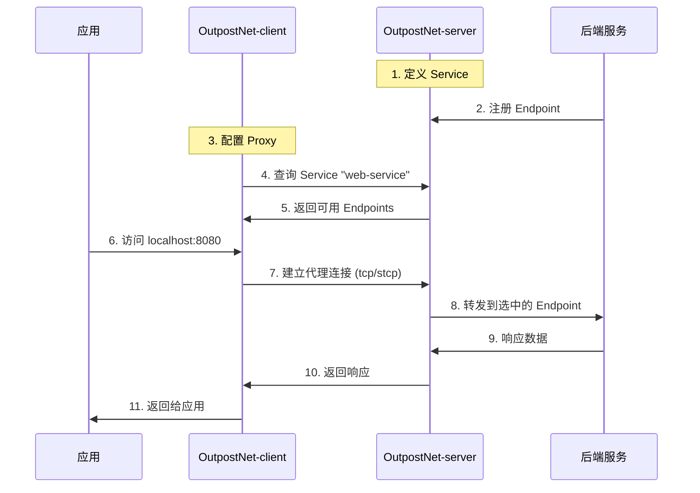

# CLAUDE.md - OutpostNet

This file provides guidance to Claude Code (claude.ai/code) when working with the OutpostNet module.

## Overview

OutpostNet 是 OutpostOS 项目的核心网络代理组件，提供轻量级的 TCP/UDP 隧道功能，专为边缘计算环境设计。

## Project Goals

### Core Objectives (按优先级排序)

#### Phase 1: 核心代理功能 (Core Proxy - 最高优先级)
- **服务端 + 客户端架构** - 实现完整的代理服务端和客户端，可替换 frps/frpc
- **多协议代理支持** - 支持 tcp、udp、stcp、sudp 四种代理模式
  - tcp/udp: 标准 TCP/UDP 透明代理
  - stcp/sudp: 安全加密隧道代理，支持点对点通信
- **支持多种通信模式** - 除了 tcp 方式外，还可以使用 Unix Socket 进行节点内通信，以便于边缘节点 IP 切换
- **云原生概念** - 引入 Kubernetes 的 Service、Endpoint、Label 等概念进行服务管理
- **配置驱动** - 通过独立配置文件定义代理规则，由 ServiceKeel Controller 生成
- **轻量级设计** - 最小化资源消耗，适合边缘环境部署

#### Phase 2: 高级功能 (Advanced Features - 高优先级)
- **跨集群通信** - 支持边缘节点、边缘集群、云边之间的服务通信和调用
- **分级服务发现** - 实现本节点 → 跨节点 → 跨集群 → 跨云边的分级服务路由策略
- **负载均衡和故障转移** - 支持多种负载均衡算法和健康检查机制

#### Phase 3: 产品完整性 (Product Completeness - 中优先级)
- **边缘网关** - 提供类似 ingress + dns 能力 (frp http 模式)，主要为 ServiceKeel 产品完整性考虑，非核心功能

## Core Concepts (核心概念)

### 概念映射关系
OutpostNet 基于 Kubernetes 的概念进行设计，同时兼容 frp 的核心能力：

- **Service** (新增概念): 定义一组提供相同功能的后端服务，类似 K8s Service
- **Endpoint** = frp 中的 **Conn**: 具体的后端实例连接，包含 IP、端口、协议等信息  
- **Label**: 用于服务选择和路由的元数据标签
- **Proxy**: 代理配置，定义如何访问 Service


### 概念层次关系
```
Service (逻辑服务)
├── metadata
│   ├── name: "web-service"
│   ├── namespace: "default"  
│   └── labels: {app: "web", version: "v1"}
├── spec
│   ├── selector: {app: "web"}
│   ├── ports: [{name: "http", port: 80, targetPort: 8080}]
│   └── proxy_mode: "tcp"  # tcp/udp/stcp/sudp
└── endpoints (动态发现的后端实例)
    ├── endpoint1: {ip: "10.1.1.1", port: 8080, protocol: "tcp"}
    ├── endpoint2: {ip: "10.1.1.2", port: 8080, protocol: "tcp"}
    └── endpoint3: {ip: "10.1.1.3", port: 8080, protocol: "tcp"}
```

## User Workflow (用户使用流程)

### 服务提供方流程 (Service Provider)

#### 1. 定义 Service
用户在 OutpostNet-server 中定义要提供的服务：
```yaml
# server-config.yaml
services:
  - name: "web-service"
    namespace: "default"
    labels:
      app: "web"
      version: "v1"
    selector:
      app: "web"  # 选择哪些 endpoints
    ports:
      - name: "http" 
        port: 80
        targetPort: 8080
        protocol: "tcp"
    proxy_mode: "tcp"  # tcp/udp/stcp/sudp
```

#### 2. 注册 Endpoints  
后端服务实例启动时，向 OutpostNet-server 注册自己：
```yaml
# 自动注册或手动配置
endpoints:
  - service: "web-service"
    ip: "10.1.1.1"
    port: 8080
    labels:
      app: "web"
      node: "edge-node-1"
```

### 服务消费方流程 (Service Consumer)

#### 3. 配置 Proxy
客户端配置要访问的服务：
```yaml
# client-config.yaml  
proxies:
  - name: "web-proxy"
    service_name: "web-service"
    service_namespace: "default"
    local_port: 8080
    proxy_mode: "tcp"
    # 可选：服务选择器
    selector:
      version: "v1"  # 只访问 v1 版本的服务
```

#### 4. 服务发现和负载均衡
OutpostNet-client 根据配置：
1. 发现 "web-service" 的所有可用 endpoints
2. 根据 selector 过滤符合条件的 endpoints  
3. 应用负载均衡策略（轮询、权重等）
4. 建立到选中 endpoint 的代理连接

### 完整交互流程



### 配置文件示例

#### OutpostNet-server 完整配置
```yaml
# OutpostNet-server.yaml
server:
  listen_addr: "0.0.0.0:7000"
  auth_token: "your-secret-token"

services:
  - name: "web-service"
    namespace: "default"
    labels:
      app: "web"
      version: "v1"
    selector:
      app: "web"
    ports:
      - name: "http"
        port: 80 
        targetPort: 8080
        protocol: "tcp"
    proxy_mode: "tcp"
    load_balancer: "round_robin"  # round_robin/weighted/least_conn

  - name: "db-service"
    namespace: "default"
    labels:
      app: "database"
    selector:
      app: "database"
    ports:
      - name: "mysql"
        port: 3306
        targetPort: 3306
        protocol: "tcp"
    proxy_mode: "stcp"  # 数据库使用加密隧道
```

#### OutpostNet-client 完整配置  
```yaml
# OutpostNet-client.yaml
client:
  server_addr: "OutpostNet-server:7000"
  auth_token: "your-secret-token"

proxies:
  - name: "web-proxy"
    service_name: "web-service"
    service_namespace: "default"
    local_port: 8080
    proxy_mode: "tcp"
    
  - name: "db-proxy"
    service_name: "db-service" 
    service_namespace: "default"
    local_port: 3306
    proxy_mode: "stcp"
    selector:
      zone: "same-region"  # 只连接同区域的数据库
```

## Architecture Understanding (架构理解)

### 服务注册与发现机制

#### 1. 服务注册流程 (Service Registration)
- **主动注册模式**: 后端服务实例启动时，主动向 OutpostNet-server 注册自己
- **注册信息包含**:
  - 服务基本信息: name, namespace, labels
  - 网络信息: ip, port, protocol
  - 元数据: 健康状态, 权重, 地理位置等
- **服务端维护**: OutpostNet-server 维护一个动态的服务列表，包含所有注册的服务实例及其元数据

#### 2. 服务发现与访问范围 (Service Discovery & Access Scope)
- **访问范围定义**: 用户访问服务时需要指定服务范围，类似 K8s 的 Service + Endpoint 逻辑
- **服务范围组成**:
  ```
  服务范围 = Service Definition + Endpoint Selection
  
  Service Definition (服务定义):
  - service_name: "web-service" 
  - service_namespace: "default"
  - selector: {app: "web", version: "v1"}  # 选择符合条件的 endpoints
  
  Endpoint Selection (端点选择):
  - 根据 selector 从注册的服务实例中筛选
  - 应用负载均衡策略选择具体的 endpoint
  - 考虑健康状态、地理位置等因素
  ```

#### 3. 具体工作流程

##### 服务端 (OutpostNet-server)
```
1. 维护服务注册表
   services_registry = {
     "default/web-service": {
       metadata: {name: "web-service", namespace: "default", labels: {...}}
       endpoints: [
         {ip: "10.1.1.1", port: 8080, labels: {app: "web", version: "v1", node: "edge-1"}},
         {ip: "10.1.1.2", port: 8080, labels: {app: "web", version: "v1", node: "edge-2"}},
         {ip: "10.1.1.3", port: 8080, labels: {app: "web", version: "v2", node: "edge-3"}}
       ]
     }
   }

2. 处理服务查询请求
   - 接收 client 的服务查询 (service_name + namespace + selector)
   - 根据 selector 筛选符合条件的 endpoints
   - 返回可用的 endpoint 列表

3. 处理代理连接
   - 接收 client 的代理连接请求
   - 根据负载均衡策略选择目标 endpoint  
   - 建立到目标 endpoint 的连接并转发数据
```

##### 客户端 (OutpostNet-client)
```
1. 服务发现
   - 根据配置中的 service_name + namespace + selector
   - 向 OutpostNet-server 查询可用的 endpoints
   - 缓存 endpoint 列表（可选）

2. 代理建立
   - 监听本地端口 (local_port)
   - 当应用访问本地端口时，建立到 OutpostNet-server 的连接
   - server 根据负载均衡策略转发到具体的 endpoint

3. 动态更新
   - 定期或事件驱动地更新 endpoint 列表
   - 处理 endpoint 的上线/下线变化
```

#### 4. 服务范围示例

```yaml
# 客户端配置：访问范围定义
proxies:
  - name: "web-v1-proxy"
    service_name: "web-service"
    service_namespace: "default"
    local_port: 8080
    selector:
      app: "web"
      version: "v1"        # 只访问 v1 版本
      zone: "same-region"  # 只访问同区域的实例
    load_balancer: "round_robin"
```

对应的服务发现过程：
```
1. 查询: "default/web-service" 
2. 筛选: selector {app: "web", version: "v1", zone: "same-region"}
3. 结果: 返回符合条件的 endpoint 列表
4. 负载均衡: 在符合条件的 endpoints 中进行负载均衡选择
```

#### 5. 关键设计点

- **服务注册**: 采用主动注册模式，服务实例自主向 server 注册
- **元数据丰富**: 支持灵活的 labels 和元数据，便于服务筛选和路由
- **访问范围**: 通过 service + selector 定义访问范围，实现精细化的服务访问控制
- **动态性**: 支持服务实例的动态注册/注销，实时更新服务列表
- **负载均衡**: 在 server 端进行负载均衡决策，client 端负责发现和连接

### 统一的服务模型设计

#### 设计理念：统一到服务
基于重新思考，决定将所有代理模式（tcp/udp/stcp/sudp）统一到 **Service + Endpoint** 模型，避免架构分裂，参考 Kubernetes NodePort 模式的设计思路。

#### 四种代理模式的统一架构

##### 1. TCP 模式 - NodePort 风格
- **参考 K8s NodePort**: 在 server 上暴露特定端口，映射到服务
- **工作流程**：
  ```
  1. Server 在指定端口监听 TCP 连接
  2. Client 连接到 server 的暴露端口
  3. Server 根据端口映射找到对应的 Service
  4. Server 从 Service 的 endpoints 中负载均衡选择目标
  5. 建立到目标 endpoint 的 TCP 连接并转发数据
  ```

##### 2. UDP 模式 - NodePort 风格  
- **类似 TCP 模式**: 在 server 上暴露 UDP 端口，映射到服务
- **工作流程**: 与 TCP 类似，但处理 UDP 数据包转发

##### 3. STCP 模式 - 服务发现风格
- **点对点安全隧道**: 连接时指定服务名，动态发现 endpoints
- **工作流程**：
  ```
  1. Client 发起 STCP 连接，携带服务名信息
  2. Server 根据服务名查询 Service 注册表
  3. Server 负载均衡选择目标 endpoint
  4. 建立加密隧道到目标 endpoint
  ```

##### 4. SUDP 模式 - 服务发现风格
- **类似 STCP**: 但处理 UDP 数据包的加密传输

#### 核心流程总结

#### TCP 模式具体流程 (NodePort 类型)

##### 初始化阶段
1. **Server 启动**:
   - OutpostNet-server 启动，监听控制端口 (如 7000)
   - 读取配置文件，解析 Service 定义
   - 为 NodePort 类型的 Service 分配并监听对应端口

2. **服务注册**:
   ```
   后端实例 -> OutpostNet-server:7000 (控制连接)
   发送: {action: "register", service: "web-service", ip: "10.1.1.1", port: 8080, labels: {app: "web"}}
   ```

3. **Client 启动**:
   - OutpostNet-client 启动，读取代理配置
   - 连接到 OutpostNet-server 的控制端口进行认证
   - 为每个 proxy 在本地监听端口 (如 8080)

##### 数据代理阶段
4. **应用发起连接**:
   ```
   应用 -> OutpostNet-client:8080 (TCP连接)
   ```

5. **Client 建立代理连接**:
   ```
   OutpostNet-client -> OutpostNet-server:30080 (NodePort直连)
   # 直接连接到 Service 的 NodePort，无需额外的服务发现
   ```

6. **Server 处理连接**:
   ```
   - 接收来自 client 的连接到 NodePort:30080
   - 根据端口映射找到对应的 Service: "web-service"
   - 查询 "web-service" 的可用 endpoints
   - 根据 selector {app: "web"} 过滤 endpoints
   - 应用负载均衡算法选择目标 endpoint (如 10.1.1.1:8080)
   ```

7. **建立后端连接**:
   ```
   OutpostNet-server -> 10.1.1.1:8080 (目标后端)
   ```

8. **数据转发**:
   ```
   应用 <-> OutpostNet-client:8080 <-> OutpostNet-server:30080 <-> 后端:8080
                [本地]              [NodePort]            [选中的endpoint]
   ```

##### 关键流程对比 (四种模式)

| 模式 | 连接方式 | 服务发现时机 | 负载均衡位置 |
|------|----------|--------------|--------------|
| **TCP** | Client→Server NodePort | Server端，连接时查询 | Server端 |
| **UDP** | Client→Server NodePort | Server端，连接时查询 | Server端 |
| **STCP** | Client→Server 控制连接+服务名 | Server端，连接时查询 | Server端 |
| **SUDP** | Client→Server 控制连接+服务名 | Server端，连接时查询 | Server端 |

##### TCP vs STCP 的关键差异

**TCP (NodePort)**:
- Client 直接连接到固定的 NodePort 端口
- Server 根据端口号找到对应的 Service
- 类似传统的端口转发，但加入了服务抽象

## STCP 模式详细设计 (ClusterIP 类型)

### STCP 模式特点
- **虚拟应用网络**: 参考 Skupper 的 VAN 概念，创建跨边缘集群的虚拟应用网络
- **零信任服务模型**: 借鉴 OpenZiti 的零信任理念，基于身份的服务访问控制
- **安全隧道**: 点对点加密传输，适合敏感数据
- **服务发现**: 通过服务名动态发现目标 endpoints
- **Dark Service**: 服务默认不暴露在网络中，只有通过 OutpostNet 网络才能访问
- **ClusterIP 类型**: 类似 K8s ClusterIP，通过服务名访问而非固定端口

### 分布式证书认证模型 (控制面解耦设计)

#### 证书颁发架构
OutpostNet 采用分布式 PKI 体系，支持控制面离线的场景下进行服务间认证：

```yaml
# PKI 层次结构
certificate_authority:
  root_ca: "OutpostNet-root-ca.crt"          # 根证书，离线保存
  intermediate_cas:
    - name: "edge-cluster-ca"             # 边缘集群 CA
      cert: "edge-cluster-ca.crt"
      key: "edge-cluster-ca.key"
      scope: ["edge-cluster-*"]
      
    - name: "service-ca"                  # 服务 CA
      cert: "service-ca.crt" 
      key: "service-ca.key"
      scope: ["service-*"]

# 证书分发策略 - 预分发而非在线验证
certificate_distribution:
  strategy: "pre_distributed"             # 预分发策略
  trust_bundle: "OutpostNet-trust-bundle.pem" # 包含所有可信 CA
  update_mechanism: "gossip_protocol"     # 使用 gossip 协议更新信任束
```

#### 身份证书定义
每个服务组件都有独立的身份证书，包含访问权限信息：

```yaml
# 服务提供方证书
service_provider_cert:
  subject: "CN=db-service-provider,O=OutpostNet,OU=edge-cluster-1"
  extensions:
    # 自定义扩展字段包含权限信息
    OutpostNet_identity:
      type: "service_provider"
      service_name: "db-service"
      namespace: "default"
      labels: {app: "mysql", zone: "east", role: "provider"}
      capabilities: ["accept_connections", "register_endpoints"]
      
    OutpostNet_policies:
      # 嵌入式策略，无需在线查询
      allowed_consumers: 
        - pattern: "CN=*-consumer,OU=edge-cluster-*"
          protocols: ["stcp"]
          max_connections: 100
      access_conditions:
        - time_window: "always"
        - rate_limit: "unlimited"

# 服务消费方证书  
service_consumer_cert:
  subject: "CN=web-service-consumer,O=OutpostNet,OU=edge-cluster-1"
  extensions:
    OutpostNet_identity:
      type: "service_consumer" 
      consumer_id: "web-service-consumer"
      labels: {app: "web", zone: "east", role: "consumer"}
      capabilities: ["initiate_connections", "discover_services"]
      
    OutpostNet_access_rights:
      # 证书中嵌入访问权限，支持离线验证
      allowed_services:
        - service_pattern: "db-service"
          namespaces: ["default"]
          protocols: ["stcp"]
          access_level: "read_write"
        - service_pattern: "cache-service"
          namespaces: ["default", "cache"]
          protocols: ["tcp", "stcp"]
          access_level: "read_only"
```

#### 离线认证机制 (无需控制面参与)

OutpostNet 支持完全离线的服务间认证，策略直接嵌入在证书中：

```yaml
# 离线认证流程
offline_authentication:
  step1_certificate_validation:
    - 验证证书链: consumer_cert -> service_ca -> root_ca
    - 检查证书有效期和吊销状态 (CRL 或 OCSP)
    - 提取证书扩展字段中的身份和权限信息
    
  step2_policy_matching:
    - 从 provider 证书提取 allowed_consumers 策略
    - 从 consumer 证书提取 allowed_services 权限
    - 进行本地策略匹配，无需访问控制面
    
  step3_access_decision:
    - 双向权限验证: provider 允许 && consumer 有权限
    - 检查协议、命名空间、访问级别等细节
    - 生成会话密钥用于后续通信

# 证书撤销处理 (离线场景)
certificate_revocation:
  crl_distribution:
    - 定期通过 gossip 协议分发 CRL
    - 本地缓存撤销列表，定期更新
    - 支持增量 CRL 减少网络开销
    
  emergency_revocation:
    - 紧急撤销通过广播机制快速传播
    - 节点间相互验证撤销信息的可信度
    - 达到阈值后生效，防止单点恶意撤销
```

#### 分布式服务发现 (去中心化)

为了支持控制面离线，OutpostNet 实现分布式服务注册表：

```yaml
distributed_service_registry:
  # 本地服务注册表
  local_registry:
    storage: "embedded_etcd"              # 本地 etcd 存储
    services:
      - name: "db-service"
        endpoints: ["10.1.1.1:3306"]
        provider_cert_hash: "sha256:abcd..."
        last_seen: "2024-01-01T10:00:00Z"
        
  # 服务同步机制  
  service_sync:
    protocol: "gossip_based"              # 基于 gossip 的服务同步
    sync_interval: "30s"
    conflict_resolution: "timestamp_wins" # 时间戳优先解决冲突
    
  # 邻居发现
  neighbor_discovery:
    method: "mDNS + manual_config"        # mDNS 自动发现 + 手动配置
    heartbeat_interval: "10s"
    failure_detection: "phi_accrual"      # φ failure detector
```

#### 虚拟应用网络拓扑 (参考 Skupper VAN)
OutpostNet 创建跨边缘节点的虚拟应用网络：

```
                     OutpostNet 虚拟应用网络 (VAN)
    ┌─────────────────────────────────────────────────────────────┐
    │                                                             │
    │  Edge Cluster A          Cloud Center          Edge Cluster B  │
    │  ┌─────────────┐         ┌─────────────┐       ┌─────────────┐ │
    │  │OutpostNet-node │◄────────┤OutpostNet-hub  ├──────►│OutpostNet-node │ │
    │  │  identity:  │         │  router &   │       │  identity:  │ │
    │  │ edge-node-1 │         │ controller  │       │ edge-node-2 │ │
    │  │             │         │             │       │             │ │
    │  │ services:   │         │ policies:   │       │ services:   │ │
    │  │ - db-mysql  │         │ - access    │       │ - web-app   │ │
    │  │ - api-svc   │         │ - routing   │       │ - cache     │ │
    │  └─────────────┘         └─────────────┘       └─────────────┘ │
    └─────────────────────────────────────────────────────────────────┘
```

### STCP 具体流程

#### 初始化阶段
1. **Server 启动**:
   - OutpostNet-server 启动，监听控制端口 (如 7000)
   - 解析 ClusterIP 类型的 Service 定义
   - 初始化 STCP 处理器和服务注册表

2. **分布式服务注册** (OutpostNet-client register 模式):
   - 后端服务节点启动 OutpostNet-client，进行本地服务注册
   - 无需与中心控制面通信，通过 gossip 协议广播服务信息
   ```
   # 本地服务注册 (无需中心服务器)
   OutpostNet-client register 启动流程:
   
   1. 加载服务提供方证书 db-service-provider.crt
   2. 验证证书有效性和权限 (离线验证)
   3. 注册到本地服务注册表:
   {
     action: "local_register",
     service: {
       name: "db-service",
       namespace: "default",
       local_addr: "127.0.0.1", 
       local_port: 3306,
       protocol: "stcp"
     },
     endpoint: {
       id: "endpoint-db-1",
       ip: "10.1.1.1",
       port: 3306,
       provider_cert: "sha256:hash_of_cert",
       labels: {app: "mysql", zone: "east"}
     }
   }
   
   4. 通过 gossip 协议向邻居节点广播服务信息
   5. 开始监听来自 consumer 的直接连接请求
   ```

3. **分布式服务发现** (OutpostNet-client proxy 模式):
   - 客户端节点启动 OutpostNet-client，进行本地服务发现
   - 无需与中心控制面通信，直接查询本地和邻居的服务注册表
   ```
   # 分布式服务发现 (无需中心服务器)
   OutpostNet-client proxy 启动流程:
   
   1. 加载服务消费方证书 web-service-consumer.crt
   2. 验证证书有效性和包含的访问权限
   3. 从证书扩展中提取 allowed_services 列表
   4. 查询本地服务注册表寻找 "db-service":
   {
     action: "local_discovery",
     query: {
       service_name: "db-service",
       namespace: "default",
       required_protocol: "stcp"
     }
   }
   
   5. 如果本地没有找到，通过 gossip 查询邻居节点
   6. 获取到服务端点信息:
   ```
   发现结果:
   {
     service_name: "db-service",
     endpoints: [
       {
         id: "endpoint-db-1",
         ip: "10.1.1.1",
         port: 3306,
         provider_cert_hash: "sha256:abcd...",
         labels: {app: "mysql", zone: "east"},
         last_seen: "2024-01-01T10:00:00Z"
       }
     ]
   }
   ```
   7. 在本地监听代理端口 (如 3306)

#### 点对点连接建立阶段 (无中心服务器)
4. **应用发起连接**:
   ```
   应用 -> OutpostNet-client(proxy):3306 (TCP连接)
   ```

5. **Proxy 直接连接 Provider**:
   - OutpostNet-client(proxy) 直接连接到服务提供方，无需经过中心服务器
   ```
   OutpostNet-client(proxy) -> OutpostNet-client(register):10.1.1.1:3306 (直接 mTLS 连接)
   
   mTLS 握手过程:
   1. TCP 连接建立
   2. TLS ClientHello + 客户端证书 (web-service-consumer.crt)
   3. TLS ServerHello + 服务端证书 (db-service-provider.crt)
   4. 双方验证证书链和扩展字段权限
   ```

6. **双向证书认证与策略验证**:
   ```
   Provider 端验证:
   1. 验证 consumer 证书链: web-service-consumer.crt -> service-ca -> root-ca
   2. 检查证书是否在 CRL 中
   3. 从证书扩展提取 consumer 身份信息
   4. 检查 provider 证书中的 allowed_consumers 策略:
      - 模式匹配: "CN=*-consumer,OU=edge-cluster-*" ✓
      - 协议检查: protocols包含"stcp" ✓
      - 连接数限制: current_connections < max_connections ✓
   
   Consumer 端验证:
   1. 验证 provider 证书链: db-service-provider.crt -> service-ca -> root-ca
   2. 检查证书是否在 CRL 中  
   3. 从证书扩展提取 provider 身份信息
   4. 检查 consumer 证书中的 allowed_services 权限:
      - 服务名匹配: "db-service" ✓
      - 命名空间匹配: "default" ✓
      - 协议匹配: "stcp" ✓
      - 访问级别: "read_write" ✓
   
   双向验证成功 -> 建立 STCP 加密隧道
   ```

7. **建立端到端 STCP 隧道**:
   ```
   认证成功后，建立点对点加密隧道:
   
   1. 协商会话密钥 (基于 mTLS 连接)
   2. OutpostNet-client(register) 连接本地后端服务 127.0.0.1:3306
   3. 建立三层连接结构:
      - 应用层: proxy ↔ register
      - 传输层: STCP 加密隧道  
      - 业务层: register ↔ 后端服务
   ```

8. **点对点数据加密传输**:
   ```
   完全去中心化的数据流:
   
   应用 <-> OutpostNet-client(proxy):3306 <-> [STCP加密隧道] <-> OutpostNet-client(register) <-> 后端:3306
          [本地连接]                        [点对点mTLS+AES]                   [本地连接]
   
   数据流特点:
   - 无中心服务器参与数据转发
   - 端到端加密，中间节点无法解密
   - 基于证书的访问控制，无需在线权限验证
   - 支持控制面完全离线的场景
   ```

### 分布式故障检测和自愈机制

#### 去中心化的服务变更通知
基于 gossip 协议的分布式服务状态同步：

```yaml
# 服务状态变更广播 (gossip 协议)
service_state_gossip:
  # 新 endpoint 上线广播
  endpoint_announce:
    type: "endpoint_online"
    service_name: "db-service"
    endpoint: {
      id: "endpoint-3",
      ip: "10.1.1.3", 
      port: 3306,
      provider_cert_hash: "sha256:new_hash",
      labels: {app: "mysql", zone: "east"},
      timestamp: "2024-01-01T10:05:00Z"
    }
    ttl: 300  # 5分钟 TTL
    
  # endpoint 故障检测广播  
  endpoint_failure:
    type: "endpoint_offline"
    service_name: "db-service"
    endpoint_id: "endpoint-1"
    reason: "connection_timeout"
    reporter: "edge-node-2"
    timestamp: "2024-01-01T10:10:00Z"
    
  # 多节点确认机制
  failure_confirmation:
    required_reporters: 2        # 需要2个节点确认故障
    confirmation_window: "30s"   # 30秒确认窗口
    action: "remove_from_registry"
```

#### 点对点连接故障转移
当直连隧道故障时，自动发现和切换到其他 endpoint：

```yaml
p2p_failover_process:
  failure_detection:
    # 连接级别检测
    - tcp_connection_lost
    - tls_handshake_timeout  
    - certificate_validation_failed
    - application_health_check_failed
    
  failover_strategy:
    1. 检测到连接故障
    2. 查询本地服务注册表的其他 endpoints
    3. 基于证书权限验证可访问的备用 endpoints
    4. 按优先级尝试连接 (延迟、负载、信任度)
    5. 建立新的点对点 mTLS 连接
    6. 业务流量透明切换
    
  discovery_fallback:
    # 如果本地没有可用 endpoints，启动发现
    - 通过 gossip 查询邻居节点
    - 更新本地服务注册表
    - 重试连接建立流程
```

### OutpostNet-client 的两种工作模式

#### Register 模式 (服务提供方)
- **作用**: 将本地服务注册到 OutpostNet-server
- **部署位置**: 与后端服务部署在同一节点
- **功能**:
  - 向 server 注册服务信息
  - 接受来自 server 的隧道连接请求
  - 转发隧道数据到本地后端服务

#### Proxy 模式 (服务消费方)  
- **作用**: 代理访问远程服务
- **部署位置**: 与应用客户端部署在同一节点
- **功能**:
  - 监听本地端口，接受应用连接
  - 向 server 请交建立到目标服务的隧道
  - 转发应用数据到远程服务

### STCP 分布式工作流程总结 (控制面解耦)

#### 阶段一：分布式服务注册与发现
```
1. OutpostNet-client(register) 启动，加载证书并注册服务到本地注册表
2. 通过 gossip 协议向邻居节点广播服务信息
3. OutpostNet-client(proxy) 启动，查询本地和邻居的服务注册表
4. 获取到服务 endpoints 列表，基于证书权限过滤可访问的服务
5. 无需中心服务器，完全分布式的服务发现
```

#### 阶段二：点对点隧道建立
```
1. 应用向 proxy 客户端发起连接
2. proxy 直接连接到服务 provider，发起 mTLS 握手
3. 双方交换证书并进行离线验证 (证书链 + 扩展字段权限)
4. 基于证书中嵌入的策略进行访问控制验证
5. 验证成功后建立点对点 STCP 加密隧道
6. register 客户端连接本地后端服务，开始数据转发
```

#### 阶段三：端到端加密传输
```
1. 应用数据通过 proxy 进入点对点 STCP 隧道
2. 数据使用 mTLS + AES-256-GCM 双重加密
3. 无中心服务器参与，完全的端到端加密
4. register 解密数据并转发到本地后端服务
5. 响应数据按相同路径加密返回
```

#### 阶段四：分布式故障处理与自愈
```
1. 基于 gossip 协议的分布式健康检测
2. 多节点确认机制防止误报
3. 当连接故障时，proxy 自动查询备用 endpoints
4. 基于证书权限重新建立到可用 provider 的连接
5. 支持控制面完全离线的故障恢复
```

### 虚拟应用网络路由机制 (参考 Skupper Layer 7 路由)

#### Application-Level 路由
OutpostNet 实现应用层路由，类似 Skupper 的 Layer 7 应用路由器：

```yaml
routing_topology:
  # 集群内路由
  intra_cluster:
    strategy: "direct_mesh"
    discovery: "local_registry" 
    encryption: "optional"
    
  # 跨集群路由  
  inter_cluster:
    strategy: "hub_spoke"
    discovery: "federated_registry"
    encryption: "required"
    routing_rules:
      - match:
          service_labels: {tier: "frontend"}
        route_to: ["local", "nearest_edge"]
      - match:
          service_labels: {tier: "backend"}  
        route_to: ["local", "cloud_center"]
```

#### 路由决策算法
基于 Skupper 的 VAN 概念，OutpostNet 实现智能路由：

```
路由决策因子:
1. 身份验证状态 (必须通过)
2. 策略授权结果 (必须匹配)
3. 网络延迟和可用性
4. 服务负载和健康状态
5. 地理位置和区域亲和性
6. 信任评分和安全等级

路由选择流程:
identity_verified ∧ policy_authorized → 
  health_check ∧ trust_score > threshold →
    minimize(latency) ∧ balance(load) →
      select_optimal_endpoint()
```

#### Dark Service 实现
参考 OpenZiti 的 Dark Service 概念：

```yaml
dark_service_config:
  default_exposure: "none"          # 服务默认不暴露
  access_method: "identity_based"   # 基于身份的访问
  network_visibility: "zero"        # 网络不可见
  
  exposure_rules:
    - service_selector: {app: "database"}
      expose_to: 
        - identity_pattern: "*-consumer"
          protocols: ["stcp"]
          conditions: ["authenticated", "authorized"]
    
    - service_selector: {tier: "public-api"}  
      expose_to:
        - identity_pattern: "api-gateway-*"
          protocols: ["tcp", "stcp"]
          rate_limits: ["1000req/min"]
```

### STCP 优化后的核心优势

#### 相比传统网络代理的改进

| 特性 | 传统代理 (frp) | OutpostNet STCP (分布式优化) |
|------|----------------|--------------------------|
| **安全模型** | 基于令牌认证 | 分布式 PKI + mTLS 双向认证 |
| **访问控制** | 简单端口映射 | 证书嵌入式策略 + 离线验证 |
| **服务暴露** | 端口暴露到公网 | Dark Service (证书授权访问) |
| **路由机制** | 中心服务器转发 | 点对点直连 + 分布式路由 |
| **故障处理** | 手动重连 | 分布式故障检测 + 自动切换 |
| **网络拓扑** | 中心化 hub | 分布式网格 + gossip 协议 |
| **控制面依赖** | 强依赖中心服务器 | 支持控制面完全离线 |
| **证书管理** | 无 | 分层 PKI + CRL 分发 |

#### 核心创新点

1. **分布式证书认证体系**
   - 基于 X.509 证书的身份标识和权限嵌入
   - 支持控制面离线的点对点认证
   - 分层 PKI 架构 + gossip 协议的 CRL 分发

2. **去中心化服务网格**
   - 完全分布式的服务注册和发现
   - 点对点直连，无中心服务器参与数据转发
   - 基于 gossip 协议的服务状态同步

3. **嵌入式策略模型**
   - 访问策略直接嵌入在证书扩展字段中
   - 支持离线策略验证，无需在线查询
   - 双向权限验证 (provider + consumer)

4. **弹性网络架构**
   - 支持控制面完全离线的服务通信
   - 分布式故障检测和自动故障转移
   - 多节点确认机制防止单点故障误报

5. **端到端安全**
   - mTLS + AES-256-GCM 双重加密
   - Dark Service (证书授权才能发现和访问)
   - 零信任架构，每个连接都需要证书验证

#### 适用场景对比

```yaml
适用场景矩阵:
  边缘计算 + 控制面离线:
    推荐: OutpostNet STCP (分布式模式)
    原因: 完全去中心化 + 证书认证 + 支持离线运行
    
  高安全要求 + 零信任网络:
    推荐: OutpostNet STCP  
    原因: mTLS双向认证 + 证书嵌入策略 + Dark Service
    
  微服务网格 + 跨云部署:
    推荐: OutpostNet STCP
    原因: 点对点直连 + 分布式服务发现 + 故障自愈
    
  传统网络代理替换:
    推荐: 渐进式迁移 (frp → OutpostNet TCP → OutpostNet STCP)
    原因: 向前兼容 + 平滑演进 + 逐步增强安全性
    
  军工/政企级安全要求:
    推荐: OutpostNet STCP + 自建PKI
    原因: 完全自主可控 + 离线运行 + 证书级访问控制
```


### STCP vs TCP 的关键差异

| 特性 | TCP (NodePort) | STCP (ClusterIP) |
|------|----------------|------------------|
| **连接方式** | 直连固定端口 | 控制连接+服务名 |
| **端口分配** | 预分配 NodePort | 动态连接，无需预分配 |
| **服务发现** | 端口→Service | 服务名→Service |
| **安全性** | 明文传输 | 加密隧道 |
| **适用场景** | 简单转发 | 敏感数据传输 |

### STCP 配置示例

#### Server 配置
```yaml
# OutpostNet-server.yaml
server:
  listen_addr: "0.0.0.0:7000"
  auth_token: "secret"

services:
  - name: "db-service"
    namespace: "default"
    type: "ClusterIP"        # STCP 使用 ClusterIP 类型
    selector:
      app: "mysql"
    ports:
      - name: "mysql"
        port: 3306           # Service 端口
        targetPort: 3306     # 目标端口
        protocol: "stcp"     # 指定 STCP 协议
    load_balancer: "round_robin"
```

#### Client Register 模式配置 (服务提供方)
```yaml
# OutpostNet-client-register.yaml  
client:
  server_addr: "OutpostNet-server:7000"
  auth_token: "secret"
  mode: "register"           # 注册模式

services:
  - name: "db-service"
    namespace: "default"
    local_addr: "127.0.0.1"  # 本地后端服务地址
    local_port: 3306         # 本地后端服务端口
    labels:
      app: "mysql"
      zone: "east"
      node: "edge-node-1"
```

#### Client Proxy 模式配置 (服务消费方)
```yaml
# OutpostNet-client-proxy.yaml
client:
  server_addr: "OutpostNet-server:7000"
  auth_token: "secret"
  mode: "proxy"              # 代理模式

proxies:
  - name: "db-proxy"
    service_name: "db-service"
    service_namespace: "default"
    local_port: 3306         # 本地监听端口
    protocol: "stcp"         # 使用 STCP 协议
    selector:                # 可选的端点过滤
      zone: "east"
```

### 部署示例

#### 后端服务节点 (提供 MySQL 服务)
```bash
# 启动 MySQL 服务
docker run -d --name mysql -p 3306:3306 mysql:8.0

# 启动 OutpostNet-client (register 模式)
./OutpostNet-client -config OutpostNet-client-register.yaml
```

#### 客户端节点 (访问 MySQL 服务)
```bash
# 启动 OutpostNet-client (proxy 模式)  
./OutpostNet-client -config OutpostNet-client-proxy.yaml

# 应用通过本地端口访问远程 MySQL
mysql -h 127.0.0.1 -P 3306 -u user -p
```

### STCP 安全机制

#### 加密方案
- **对称加密**: AES-256-GCM 用于数据传输
- **密钥交换**: 使用控制连接进行密钥协商
- **认证**: 基于预共享密钥 (auth_token) 

#### 隧道建立流程
1. Client 通过控制连接请求服务
2. Server 验证权限并选择 endpoint
3. 建立到目标的连接
4. 协商加密密钥
5. 开始加密数据传输

#### 统一架构流程

```
                        OutpostNet-server
                    ┌─────────────────────┐
                    │   Service Registry  │
                    │  ┌───────────────┐  │
Client (NodePort)   │  │ web-service   │  │
App -> :8080 ──────────> NodePort:30080──────> endpoints
                    │  │ (tcp)         │  │   load balance
                    │  └───────────────┘  │
                    │  ┌───────────────┐  │
Client (ClusterIP)  │  │ db-service    │  │
App -> :3306 ──────────> service name ──────> endpoints  
                    │  │ (stcp)        │  │   load balance
                    │  └───────────────┘  │
                    └─────────────────────┘
```

#### 优势
- **统一的概念模型**: 所有模式都使用 Service + Endpoint
- **配置一致性**: 相同的配置结构和语义
- **K8s 兼容性**: 概念与 K8s Service 高度一致
- **灵活性**: 支持 NodePort 和 ClusterIP 两种访问方式
- **简化理解**: 用户只需理解一套概念体系

### Service Discovery Hierarchy (分级服务发现架构)

OutpostNet 实现多层次的服务发现和路由机制，确保在边缘环境中的服务可用性和性能优化：

#### Level 1: 本节点服务 (Local Node Services)
- **优先级**: 最高
- **延迟**: < 1ms
- **适用场景**: 同一 Pod 内或同一节点内的服务调用
- **实现方式**: 直接本地代理，无需网络传输

#### Level 2: 跨节点服务 (Cross-Node Services)  
- **优先级**: 高
- **延迟**: 1-10ms
- **适用场景**: 同一边缘集群内不同节点间的服务调用
- **实现方式**: 通过 OutpostNet router 进行节点间隧道通信

#### Level 3: 跨集群服务 (Cross-Cluster Services)
- **优先级**: 中
- **延迟**: 10-50ms  
- **适用场景**: 不同边缘集群间的服务调用
- **实现方式**: 通过集群间的 OutpostNet 网关进行路由

#### Level 4: 跨云边服务 (Cloud-Edge Services)
- **优先级**: 低（兜底）
- **延迟**: 50-200ms
- **适用场景**: 边缘无法提供服务时，回退到云端服务
- **实现方式**: 通过云边隧道进行服务调用

### Target Architecture Evolution

```
┌─────────────────────────────────────────────────────────────┐
│                        Cloud Services                       │
│                     (Level 4 - Fallback)                   │
└─────────────────────────┬───────────────────────────────────┘
                          │ Cloud-Edge Tunnel
┌─────────────────────────┴───────────────────────────────────┐
│                    Edge Cluster A                          │
│  ┌─────────────┐                    ┌─────────────┐        │
│  │   Node 1    │ ←─── Level 2 ────→ │   Node 2    │        │
│  │ (Level 1)   │    Cross-Node      │ (Level 1)   │        │
│  └─────────────┘                    └─────────────┘        │
└─────────────────────────┬───────────────────────────────────┘
                          │ Level 3 - Cross-Cluster
┌─────────────────────────┴───────────────────────────────────┐
│                    Edge Cluster B                          │
│  ┌─────────────┐                    ┌─────────────┐        │
│  │   Node 3    │ ←─── Level 2 ────→ │   Node 4    │        │
│  │ (Level 1)   │    Cross-Node      │ (Level 1)   │        │
│  └─────────────┘                    └─────────────┘        │
└─────────────────────────────────────────────────────────────┘
```
